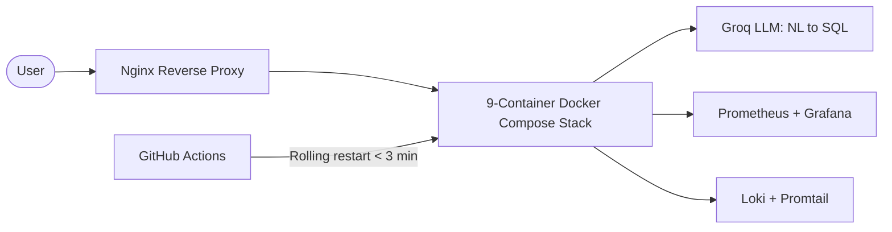
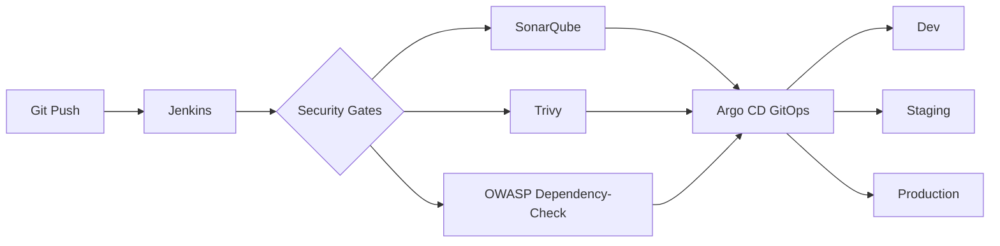
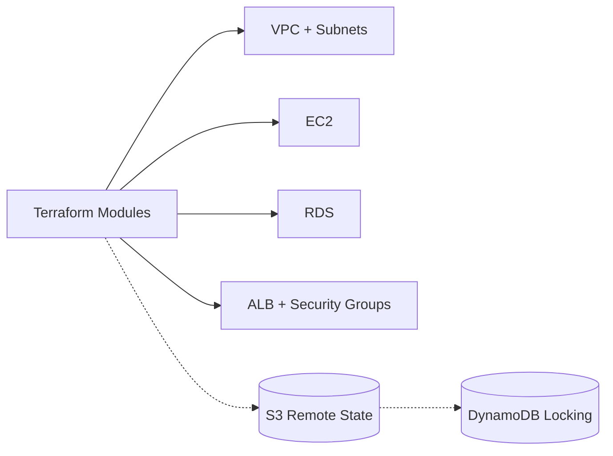

<!-- ===================== HERO ===================== -->
<p align="center">
  
</p>

<p align="center">
  
</p>

<p align="center">
  
  
  
</p>

<p align="center">
  <a href="https://linkedin.com/in/arif-awsengineer"></a>
  <a href="mailto:arif.cloud.engineer@gmail.com"></a>
  
</p>

---

## 🧑‍💻 About Me

I'm a **2025 B.Tech CSE graduate** and fresher **DevOps / Cloud Engineer** with **480+ hours of hands-on training** and **three end-to-end projects** covering **CI/CD, Docker, Kubernetes (EKS), Terraform (IaC) and monitoring on AWS**. I'm an **immediate joiner**.

<table>
<tr>
<td width="55%" valign="top">

```yaml
name:      Shaik Mahammad Arif
role:      DevOps / Cloud Engineer (Fresher)
location:  Hyderabad, India (open to Bangalore)
training:  480+ hours, NareshIT
certs:     AWS CCP, OCI DevOps Professional
focus:     CI/CD, Containers, IaC, Monitoring
joining:   Immediately
```

</td>
<td width="45%" valign="top">

🔭 **Building:** GitOps pipelines, Terraform modules, observability stacks

🌐 **Comfortable with:** TCP/IP, DNS, TLS, VPC networking, Nginx

🌱 **Learning:** Advanced AWS, Kubernetes internals, DevSecOps

💬 **Ask me about:** EC2, VPC, IAM, Jenkins, Docker, Terraform

</td>
</tr>
</table>

---

## 📈 Results at a Glance

<table align="center">
<tr>
<td align="center" width="25%"><h3>45+ → 8 min</h3><sub>build-to-deploy time<br/>across 3 CI/CD pipelines</sub></td>
<td align="center" width="25%"><h3>3 hrs → 10 min</h3><sub>environment setup<br/>with Terraform modules</sub></td>
<td align="center" width="25%"><h3>&lt; 3 min</h3><sub>rolling restarts<br/>via GitHub Actions</sub></td>
<td align="center" width="25%"><h3>3 gates</h3><sub>SonarQube, Trivy,<br/>OWASP Dependency-Check</sub></td>
</tr>
</table>

---

## 🛠️ Tech Stack

<p align="center">
  
</p>

<details open>
<summary><b>☁️ Cloud (AWS)</b></summary>
<br/>


</details>

<details open>
<summary><b>🌐 Networking</b></summary>
<br/>


</details>

<details open>
<summary><b>🔄 CI/CD · 📦 Containers · 🏗️ IaC</b></summary>
<br/>


</details>

<details open>
<summary><b>🔐 DevSecOps · 📊 Monitoring</b></summary>
<br/>


</details>

---

## 🚀 Featured Projects

### 🤖 SupaChat: AI Conversational Analytics Platform

> Natural language to SQL via the Groq LLM, running as a 9-container microservices stack on AWS EC2.



- 🐳 **9-container** Docker Compose platform behind an **Nginx reverse proxy** on **AWS EC2**
- ⚙️ **GitHub Actions** release pipeline with rolling restarts in **under 3 minutes**
- 📊 **Prometheus + Grafana** dashboards and **Loki + Promtail** log aggregation across all 9 services

[](https://github.com/arifcloudengineer/REPLACE-WITH-REPO-NAME)

<br/>

### 🔐 DevSecOps CI/CD Pipeline on AWS EKS

> GitOps delivery to dev, staging and production with three automated security gates, in under 8 minutes.



- 🔄 **Jenkins + Argo CD** GitOps pipeline on **AWS EKS** across dev, staging and production
- 🛡️ **3 automated security gates**: SonarQube, Trivy, OWASP Dependency-Check
- ⚖️ Auto-scaling node groups, **IRSA** and **Kubernetes RBAC**

[](https://github.com/arifcloudengineer/REPLACE-WITH-REPO-NAME)

<br/>

### 🏗️ AWS Infrastructure Automation with Terraform

> Reusable modules that take an environment from zero to running in under 10 minutes.



- ⚡ Environment setup cut from **3+ hours to under 10 minutes**
- 🧩 **VPC, subnets, EC2, RDS, ALB and security groups** via reusable modules
- 🔒 **S3 remote state with DynamoDB locking** for safe multi-environment management

[](https://github.com/arifcloudengineer/REPLACE-WITH-REPO-NAME)

---

## 🧭 Experience & Education

**DevOps Engineer Trainee · NareshIT, Hyderabad** *(May 2025 – Sep 2025)*
- 480+ hours of hands-on training across Git, Jenkins, Docker, Kubernetes, Terraform, Ansible and AWS
- Built 3 CI/CD pipelines for web apps and microservices, cutting build-to-deploy time from 45+ minutes to under 8

**B.Tech, Computer Science & Engineering** · Dr. K. V. Subba Reddy Institute of Technology, Kurnool *(Nov 2021 – Apr 2025)*

## 🏅 Certifications

| Certification | Issuer | Year |
|---|---|---|
| ☁️ AWS Certified Cloud Practitioner | Amazon Web Services | 2025 |
| 🔴 OCI 2025 DevOps Professional | Oracle | 2025 |
| 🧪 AWS Solutions Architect Job Simulation | Forage | 2025 |
| 🔧 Deploying Jenkins to Cloud | Infosys Springboard | 2025 |

---

## 📊 GitHub Stats

<p align="center">
  
  
</p>

<p align="center">
  
</p>

<p align="center">
  
</p>

---

## 📫 Let's Work Together

<p align="center">
  Looking for <b>DevOps / Cloud Engineer</b> roles in <b>Hyderabad</b> (open to <b>Bangalore</b>). <b>Immediate joiner.</b>
</p>

<p align="center">
  <a href="https://linkedin.com/in/arif-awsengineer"></a>
  <a href="mailto:arif.cloud.engineer@gmail.com"></a>
</p>

<p align="center"><i>Automate everything. Break nothing. Ship fast.</i></p>

<p align="center">
  
</p>
