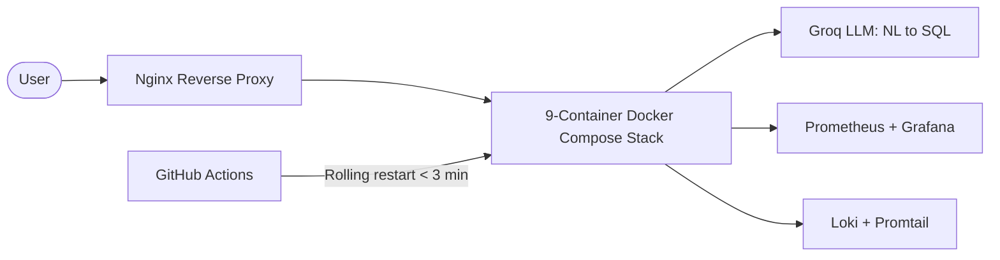
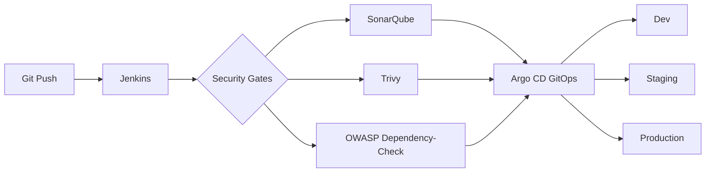
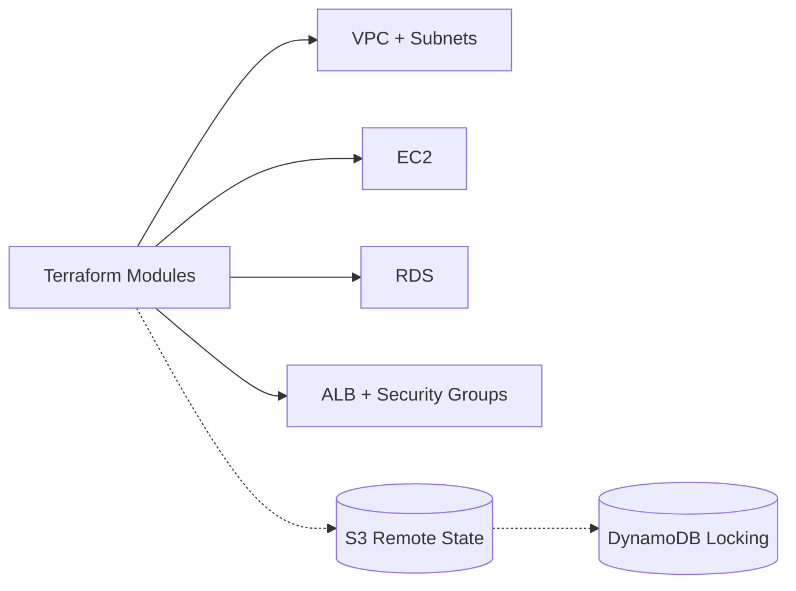

<!-- ===================== HERO ===================== -->
<p align="center">
  
</p>

<p align="center">
  
</p>

<p align="center">
  
  
  
</p>

<p align="center">
  <a href="https://linkedin.com/in/arif-awsengineer"></a>
  <a href="mailto:shaikmahammadarif98@gmail.com"></a>
  
</p>

<p align="center">
  
  
</p>

<!-- ===================== ABOUT ===================== -->


## 👨‍💻 &nbsp;About Me

<table>
<tr>
<td width="60%" valign="top">

```yaml
name:        Shaik Mahammad Arif
role:        DevOps / Cloud Engineer (Fresher)
education:   B.Tech CSE, 2025
training:    480+ hours hands-on (NareshIT)
focus:       CI/CD · Docker · Kubernetes · Terraform
cloud:       AWS (EKS, EC2, VPC, IAM, S3, RDS)
location:    Hyderabad, India → open to Bangalore
availability: Immediate joiner 🚀
```

</td>
<td width="40%" valign="top">

🔭 **Building** GitOps pipelines, IaC modules & observability stacks

🌱 **Learning** Advanced AWS, K8s internals, DevSecOps

🤝 **Collaborating on** AWS, EKS & open-source DevOps automation

💬 **Ask me about** EC2, VPC, IAM, Jenkins, Docker, Terraform

⚡ **Fun fact** I love turning slow, manual deployments into fully automated ones

</td>
</tr>
</table>

<!-- ===================== IMPACT ===================== -->


## 📈 &nbsp;Impact in Numbers

<table align="center">
<tr>
<td align="center" width="25%"><h2>45+ → 8</h2><sub>minutes<br/>build-to-deploy time</sub></td>
<td align="center" width="25%"><h2>3 hrs → 10</h2><sub>minutes<br/>environment setup (Terraform)</sub></td>
<td align="center" width="25%"><h2>&lt; 3 min</h2><sub>rolling release<br/>via GitHub Actions</sub></td>
<td align="center" width="25%"><h2>3</h2><sub>automated security gates<br/>in the pipeline</sub></td>
</tr>
</table>

<!-- ===================== SKILLS ===================== -->


## 🛠️ &nbsp;Tech Arsenal

<p align="center">
  
</p>

<details open>
<summary><b>☁️ Cloud (AWS)</b></summary>
<br/>


</details>

<details open>
<summary><b>🔄 CI/CD · 📦 Containers · 🏗️ IaC</b></summary>
<br/>


</details>

<details open>
<summary><b>🔐 DevSecOps · 📊 Monitoring</b></summary>
<br/>


</details>

<!-- ===================== PROJECTS ===================== -->


## 🚀 &nbsp;Featured Projects

### 🤖 SupaChat: AI Conversational Analytics Platform

> Natural language → SQL, powered by the Groq LLM, running as a 9-container microservices stack on AWS EC2.



- 🐳 Deployed **9 containers** with Docker Compose behind an **Nginx reverse proxy** on **AWS EC2**
- ⚙️ **GitHub Actions** release pipeline with rolling restarts in **under 3 minutes**
- 📊 **Prometheus + Grafana** dashboards and **Loki + Promtail** log aggregation across all 9 services


[](https://github.com/Shaikarif143/REPLACE-WITH-REPO-NAME)

<br/>

### 🔐 DevSecOps CI/CD Pipeline on AWS EKS

> GitOps delivery to dev, staging and production with three automated security gates, all in under 8 minutes.



- 🔄 **Jenkins + Argo CD** GitOps pipeline on **AWS EKS** across dev, staging and production
- 🛡️ **3 security gates**: SonarQube, Trivy, OWASP Dependency-Check
- ⚖️ Auto-scaling node groups, **IRSA** and **Kubernetes RBAC**


[](https://github.com/Shaikarif143/REPLACE-WITH-REPO-NAME)

<br/>

### 🏗️ AWS Infrastructure Automation with Terraform

> Reusable modules that take an environment from zero to running in under 10 minutes.



- ⚡ Environment setup cut from **3+ hours to under 10 minutes**
- 🧩 Provisioned **VPC, subnets, EC2, RDS, ALB and security groups** with reusable modules
- 🔒 **S3 remote state + DynamoDB locking** for safe multi-environment management


[](https://github.com/Shaikarif143/REPLACE-WITH-REPO-NAME)

<!-- ===================== EXPERIENCE ===================== -->


## 🧭 &nbsp;Journey

```text
2021 ──────────── 2025 ──────────── May–Sep 2025 ──────────── 2025
  │                  │                    │                      │
B.Tech CSE      Graduated          DevOps Trainee          AWS CCP + OCI DevOps
(Kurnool)       (Apr 2025)         NareshIT, Hyderabad     Professional certified
                                   480+ hrs, 3 pipelines
```

**DevOps Engineer Trainee · NareshIT, Hyderabad** *(May 2025 – Sep 2025)*
- 480+ hours of hands-on training across Git, Jenkins, Docker, Kubernetes, Terraform, Ansible and AWS
- Built 3 CI/CD pipelines for web apps and microservices, cutting build-to-deploy time from 45+ minutes to under 8

## 🏅 &nbsp;Certifications

| Certification | Issuer | Year |
|---|---|---|
| ☁️ AWS Certified Cloud Practitioner | Amazon Web Services | 2025 |
| 🔴 OCI 2025 DevOps Professional | Oracle | 2025 |
| 🧪 AWS Solutions Architect Job Simulation | Forage | 2025 |
| 🔧 Deploying Jenkins to Cloud | Infosys Springboard | 2025 |
| 🎓 Cloud Computing | NPTEL / IIT | 2024 |

<!-- ===================== STATS ===================== -->


## 📊 &nbsp;GitHub Stats

<p align="center">
  
  
</p>

<p align="center">
  
</p>

<p align="center">
  
</p>

<!-- Snake animation: needs the workflow file snake.yml (see setup notes) -->
<p align="center">
  <picture>
    <source media="(prefers-color-scheme: dark)" srcset="https://raw.githubusercontent.com/Shaikarif143/Shaikarif143/output/github-snake-dark.svg" />
    <source media="(prefers-color-scheme: light)" srcset="https://raw.githubusercontent.com/Shaikarif143/Shaikarif143/output/github-snake.svg" />
    
  </picture>
</p>

<!-- ===================== CONTACT ===================== -->


## 📫 &nbsp;Let's Work Together

<p align="center">
  I'm actively looking for <b>DevOps / Cloud Engineer</b> roles in <b>Hyderabad</b> (open to <b>Bangalore</b>) and can <b>join immediately</b>.
</p>

<p align="center">
  <a href="https://linkedin.com/in/arif-awsengineer"></a>
  <a href="mailto:shaikmahammadarif98@gmail.com"></a>
</p>

<p align="center"><i>"Automate everything. Break nothing. Ship fast."</i> ⚡</p>

<p align="center">
  
</p>
